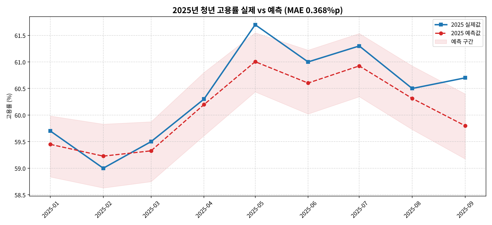
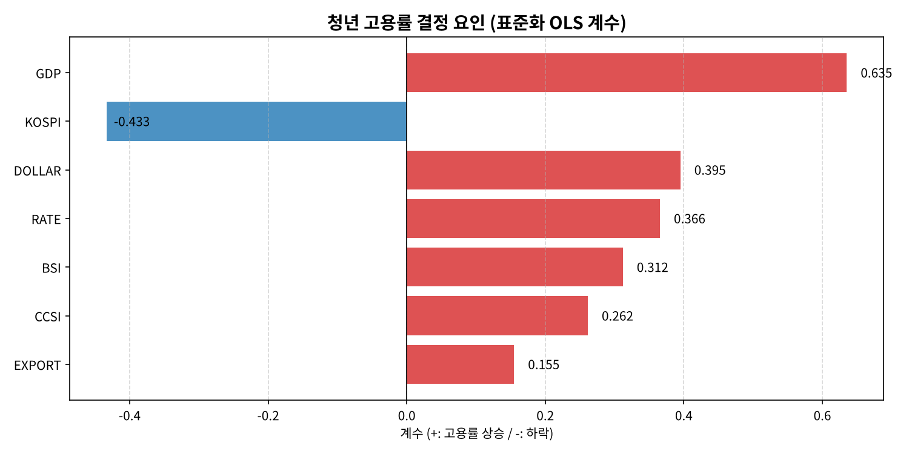

# 📈 Youth Employment Forecast

거시 경제지표로 **20대 청년 고용률의 결정 요인을 찾고**, Prophet 하이브리드 모델로 **2025년 고용률을 백테스트**한 데이터 분석 프로젝트입니다.

`25-2` · 개인 프로젝트



## 결과 요약

- 경제지표 10개 → **3단계 필터링(상관 → VIF → p-value)으로 핵심 변수 7개** 선정 (OLS R² 0.77)
- 2010~2024년으로 학습한 Prophet + Regressor 모델이 **2025년 1~9월 고용률을 MAE 0.37%p**로 맞힘
- 1차 시도(지표 예측 → OLS) 실패 원인을 분석하고 모델 구조를 바꿔 개선 → [v1 실패 기록](experiments/v1_ols_failed/)

## 분석 과정

**1. 데이터 수집** (2010-01 ~ 2025-09, 월별 189개)

| 변수 | 설명 | 출처 |
|---|---|---|
| `Job_Rate` (타겟) | 20~29세 고용률 (%) | 통계청 KOSIS |
| `GDP` | 실질 국내총생산 (분기 → 월 보간) | 한국은행 ECOS |
| `IPI` | 전산업생산지수 | 통계청 KOSIS |
| `CCSI` | 소비자심리지수 | 한국은행 ECOS |
| `BSI` | 기업경기실사지수 | 한국은행 ECOS |
| `EXPORT` | 수출금액지수 | 한국은행 ECOS |
| `RATE` | 기준금리 | 한국은행 ECOS |
| `PPI` / `CPI` | 생산자·소비자 물가지수 | 한국은행 ECOS / KOSIS |
| `KOSPI` | 코스피 월평균 (직접 크롤링) | 네이버 금융 |
| `DOLLAR` | 원/달러 환율 | 한국은행 ECOS |

**2. 전처리**: 결측 제거, 단위 차이를 없애기 위해 표준화(StandardScaler)

**3. 핵심 변수 선정**

| 단계 | 방법 | 결과 |
|---|---|---|
| 3-1 영향력 순위 | 고용률과의 피어슨 상관계수 | PPI(0.72) > DOLLAR(0.69) > CPI(0.60) … |
| 3-2 다중공선성 제거 | VIF > 10 변수 반복 제거 | CPI(182) → IPI(121) → PPI(28) 제거 |
| 3-3 유의성 검증 | OLS p-value > 0.05 반복 제거 | 7개 모두 유의 → **GDP, CCSI, BSI, EXPORT, RATE, KOSPI, DOLLAR** |



GDP·환율·금리·기업/소비자 심리가 높을수록 청년 고용률이 올라가는 관계를 보였고, KOSPI는 다른 변수를 통제했을 때 음(-)의 관계로 나타났습니다.

**4. 모델링·검증**: Prophet(추세·연간 계절성) + 7개 변수 Regressor, 2024년까지 학습 → 2025년 실제 지표로 고용률 예측

| 월 | 1 | 2 | 3 | 4 | 5 | 6 | 7 | 8 | 9 |
|---|---|---|---|---|---|---|---|---|---|
| 실제 (%) | 59.7 | 59.0 | 59.5 | 60.3 | 61.7 | 61.0 | 61.3 | 60.5 | 60.7 |
| 예측 (%) | 59.45 | 59.23 | 59.33 | 60.20 | 61.00 | 60.60 | 60.92 | 60.31 | 59.80 |

> **한계**: 백테스트에서 2025년 경제지표는 실제값을 사용했습니다. 즉 "지표가 주어졌을 때 고용률을 설명·추정하는 능력"을 검증한 것이며, 미래 지표까지 예측해야 하는 실제 전망에서는 오차가 더 커질 수 있습니다. (v1에서 이 방식의 한계를 확인)

## 구조

```text
.
├── data/
│   ├── raw/                  # 지표별 원본 데이터 (UTF-8, KOSPI는 월평균 가공값)
│   └── final_dataset.csv     # 월별 통합 데이터셋
├── src/
│   ├── collect/
│   │   ├── kospi.py          # KOSPI 일별 시세 수집(학습 목적) → 월평균
│   │   └── gdp_monthly.py    # 분기 GDP → 월별 보간
│   ├── preprocess.py         # Step 2 표준화
│   ├── select_features.py    # Step 3 상관/VIF/p-value + 계수 그래프
│   ├── forecast.py           # Step 4 Prophet 백테스트 + 그래프
│   └── common.py
├── results/                  # 선정 변수, 예측 결과, 그래프
├── experiments/v1_ols_failed/# 1차 시도 기록
└── docs/presentation.pptx
```

## 실행

```bash
pip install -r requirements.txt
cd src
python preprocess.py
python select_features.py
python forecast.py
```

## 기술 스택

Python · pandas · statsmodels · scikit-learn · Prophet · matplotlib · requests

## 데이터 출처 및 라이선스

- 경제지표: 한국은행 경제통계시스템(ECOS), 통계청 국가통계포털(KOSIS) 공개 통계 — 출처를 표기해 사용했습니다.
- KOSPI: `src/collect/kospi.py`로 수집해 **월평균 지수로만 가공**해 사용했으며(`data/raw/kospi.csv`), 일별 원본 데이터는 저장소에 포함하지 않습니다.
- 코드: [MIT](LICENSE)
